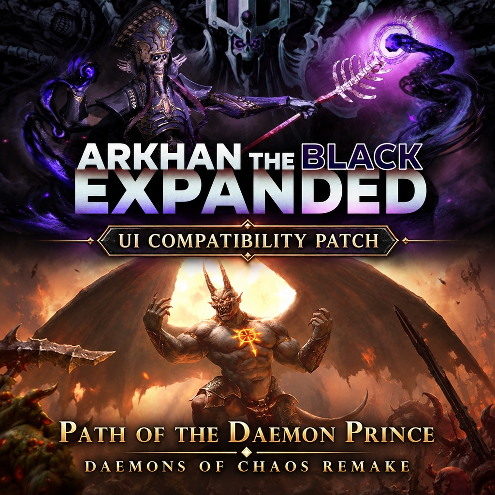

# Arkhan / Path of the Daemon Prince UI compatibility



Version 1.0.0. The restored Daemon Prince panel has been confirmed working in game.

Requires both [Arkhan the Black: Expanded](https://steamcommunity.com/sharedfiles/filedetails/?id=2852724610)
and [Path of the Daemon Prince: Daemons of Chaos Remake](https://steamcommunity.com/sharedfiles/filedetails/?id=3818631088).

Both mods replace `ui/campaign ui/province_info.twui.xml`. This optional submod
combines Arkhan’s original province panel with the Daemon Prince’s separate
Desolation for the Gods panel, preserving their own resource and ritual bindings.
It contains one UI override, with no campaign scripts or balance changes.

## Build

From the repository root, run:

```sh
python3 submods/arkhan_daemon_prince_ui_compat/build.py
```

The pack is written into this folder as `!arkhan_daemon_prince_ui_compat.pack`.
Python 3 is sufficient; no extra packages are required. To build with RPFM
instead, import only the `src/ui/` folder, keeping `ui/campaign ui/` as the internal path.
Do not import the README, build script or Workshop text into the pack.

The main mod’s default build selects only root game folders and excludes this
`submods/` source tree. This compatibility override must remain a separate pack.

## Install

Enable the pack alongside both required mods and give it higher priority than
both in WH3 Mod Manager. Disable/remove the earlier TEST pack. Load an existing
Daemon Prince save and open the province panel to check Desolation for the Gods.

## Workshop release

Use `workshop_title.txt` and `workshop_description.txt` for the listing. Add both
mods as Required Items on Workshop and use `workshop_preview.jpg` as the preview image when uploading.

Other province-panel overrides may require another compatibility patch. Updates
to either required mod may require this file to be merged again. Multiplayer has
not been tested. Disable this pack to remove its UI override.

## Credits

Stephen and the Arkhan contributors; DgBagé for Path of the Daemon Prince;
Creative Assembly for the original game assets. The Daemon Prince panel is
preserved from the supplied mod; this patch combines the two UI implementations.

Workshop artwork: composite based on the two supplied original Steam Workshop covers, edited with the built-in image generator. Promotional artwork only; excluded from the submod pack.

Game files live in `src/`. Import its contents at the pack root, without a `src/` prefix. Build scripts, documentation and Workshop metadata remain outside `src/`.
