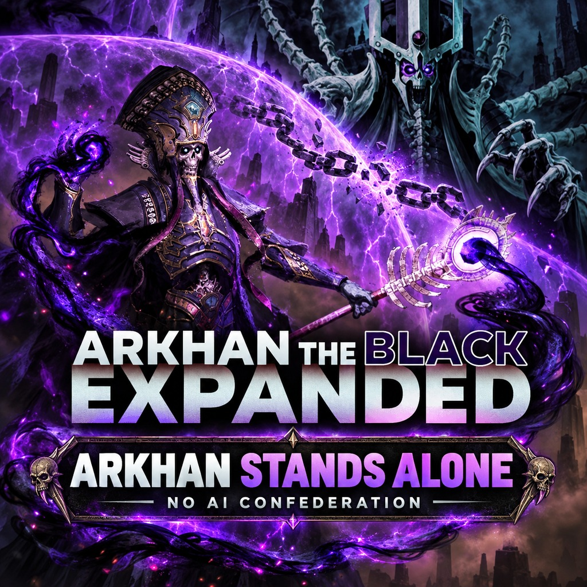

# Arkhan Stands Alone — No AI Confederation by Nagash



Version 1.0.0. User-confirmed working in game; the tested script is unchanged.
Optional companion to [Arkhan the Black: Expanded](https://steamcommunity.com/sharedfiles/filedetails/?id=2852724610).

Protects AI Arkhan against Nagash’s diplomatic confederation, Mortarch ritual
and endgame acquisition. Works with human or AI Nagash. Human Arkhan and
other Mortarch entries are left unchanged. Already-confederated Arkhan is not restored.

## Build

From the repository root:

```sh
python3 submods/arkhan_keep_ai_independent/build.py
```

This creates `arkhan_keep_ai_independent.pack` in this folder. Only standard
Python 3 is required. With RPFM, import only `src/script/` at the pack root.
The main mod’s default build excludes this `submods/` directory.

## Install and release

Enable alongside the main mod. Disable/remove `arkhan_keep_ai_independent_TEST.pack`.
There is no MCT checkbox: enabling the separate pack enables protection.
Use the Workshop title/description files and `workshop_preview.jpg` when publishing.
Add Arkhan the Black: Expanded as a Required Item on Workshop.

No full vanilla script overrides, DB files or local-player campaign mutations.
The script runs on the first tick and Arkhan/Nagash faction turns. Multiplayer
is unverified. Disabling stops the script, but restrictions saved by the game
may persist; use a pre-submod save to restore the earlier campaign state.

## Credits

Stephen and the Arkhan contributors; Creative Assembly for the original game.
Promotional cover uses the supplied original Arkhan Workshop artwork as a
reference and is edited with the built-in image generator. It is not packed.

Game files live in `src/`. Import its contents at the pack root, without a `src/` prefix. Build scripts, documentation and Workshop metadata remain outside `src/`.
