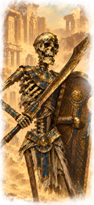
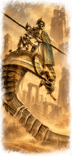
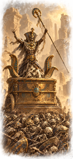
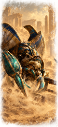

# Arkhan the Black: Expanded — Radious sandy cards

A replacement for the supplied Arkhan Radious compatibility submod, with sandy unit cards matching Radious's Tomb Kings roster. The latest supplied main build is the reference for the artwork and current unit keys.

## Installation

Enable the current Arkhan the Black: Expanded main mod, all required Radious WH3 parts (Parts 1–4 in the supplied submod's dependency list), and `!!arkhan_the_black_radious_submod_sandy.pack`. Disable the older Arkhan Radious compatibility pack and give this replacement higher priority than the main mod and Radious.

Download the pack from the **Artifacts** section of a successful [Build main mod and submods run](https://github.com/Warhammer-Mods/arkhan_the_black_expanded/actions/workflows/packfile.yml). The artifact is named `!!arkhan_the_black_radious_submod_sandy`.

## Cards

- 93 card filenames, based on 84 distinct artworks, including current character variants and RoRs.
- Small cards: **60×130**, with opaque edges.
- Infopics: **120×260**, with the same feathered alpha mask as the main mod's skeleton-warrior infopic.
- 30 matching character unit cards under `ui/portraits/units/no_culture`, at their original 60×130 size.

The artwork was rendered individually from the supplied cards, then exported at the required sizes with deterministic resizing and alpha handling. Full-resolution masters and prompts are included in the separately supplied source archive.

## Compatibility tables

All 15 DB fragments from the supplied Radious compatibility pack are retained as editable RPFM TSV exports. An additional `arkhan_radious_current_roster` fragment carries the existing balance across 17 renamed unit keys: Necrarch lord mounts, Death/Shadow/Light/Nehekhara High Liche Priests, and Cairn Wraiths.

The original 82 land-unit rows retain their authored stat values, armour, weapons and abilities. Matching model, animation and mount references use the latest supplied main build. Old rows remain for compatibility. The resulting submod contains 99 land-unit rows.

New units without an existing Radious counterpart retain main-mod values. The Coven Throne uses a matching sandy card and infopic; its combat balance comes from the main mod. See [balance_coverage.csv](balance_coverage.csv) for the current roster's coverage. The main mod supplies other unit definitions, models, localisation and campaign mechanics.

## Validation

The supplied test pack was reopened and every DB fragment decoded. All 16 TSV exports round-trip to the validated native rows. Original nonvisual stat values are checked field by field, land-unit keys are unique within the submod, and every card's dimensions and alpha are checked. A source rebuild produced a byte-identical test pack.

**In-game testing is still required**, particularly recruitment, building effects and caps, mounted lords in battle, character variants and large-card transparency. To roll back, disable this replacement and restore the original Radious compatibility pack.

The workflow checks this folder alongside the other packs, then builds packfiles one at a time. Only game folders are included in the pack.

## Credits

Arkhan the Black: Expanded and the supplied compatibility tables remain credited to their original authors. Radious is required separately. Original Total War imagery and assets belong to Creative Assembly.

## Workshop upload

[Upload instructions and prepared page text](UPLOAD.md) target the existing [Radious Workshop item](https://steamcommunity.com/sharedfiles/filedetails/?id=2865162727). This folder includes the title, description, change notes, preview and uploader thumbnail. Rename the downloaded `_sandy` build to the pack basename in the instructions when updating the existing item.
